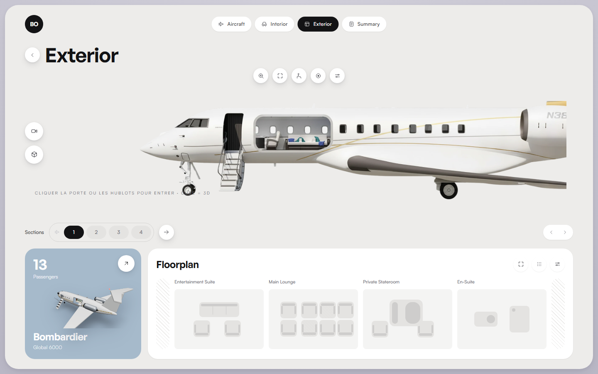

# Aéro — Réservation de jet privé en 3D

[](https://github.com/laslande24/aero-jet-configurator/actions/workflows/ci.yml)
[](LICENSE)

Configurateur-réservation de jet privé, interactif et immersif : comparez les
appareils, visitez la cabine en 3D, choisissez votre siège sur le plan de
cabine, puis réservez votre vol. Démonstration front-end complète — aucun
paiement réel.

**En ligne :** https://romaricsoh-aero.vercel.app



## Fonctionnalités

- **Vue extérieure 2D** fidèle à la maquette (profil photoréaliste, porte et
  hublots cliquables pour entrer dans la cabine), avec bascule **2D / 3D**
- **Modèle 3D procédural** manipulable (orbite + zoom) : fuselage paramétrique,
  escalier déployé, découpe cabine réelle dans la coque, liseré doré,
  immatriculation, feux de navigation
- **Visite intérieure 3D** en 4 zones thématisées (Entertainment Suite, Main
  Lounge, Private Stateroom, En-Suite) avec mobilier, matériaux et éclairage
  d'ambiance propres à chaque zone
- **Sélection de siège** synchronisée dans les deux sens entre la 3D et le
  plan de cabine (survol, sélection, sièges occupés)
- **Parcours de réservation** : trajet, passager, récapitulatif de prix,
  validation côté client et écran de confirmation animé
- **Multi-appareils** : Bombardier Global 6000 et Gulfstream G650, chacun avec
  sa configuration de cabine et sa sélection de siège persistante
- Transitions caméra cinématiques (GSAP), micro-interactions, reveal
  progressif, `prefers-reduced-motion` respecté partout

## Stack

| Domaine | Choix |
|---|---|
| Build / langage | Vite · React 19 · TypeScript |
| Styles | Tailwind CSS v4 (design tokens CSS-first) |
| 3D | three.js · React Three Fiber · drei |
| Animations | GSAP |
| État | Zustand |
| Tests | Playwright (parcours E2E complet) |

## Démarrer

```bash
npm install
npm run dev        # http://localhost:5180
```

```bash
npm run build      # build de production (dist/)
npm run preview    # sert le build
```

## Tests

Le parcours de réservation complet (21 assertions : sélection de siège,
persistance par avion, validation du formulaire, confirmation, cas limites)
est couvert par un test Playwright :

```bash
pip install playwright && python -m playwright install chromium

# un serveur doit écouter sur :5180 (npm run dev ou npm run preview)
npm run test:e2e
```

L'intégration continue rejoue lint, types, build et ce parcours à chaque push.

## Licence

[MIT](LICENSE)

## Structure

```
src/
  components/    UI (nav, plan de cabine, cartes, vue 2D…)
  data/          catalogue avions, cabines, tarification
  features/
    configurator/  écran principal
    stage/         scène 3D (extérieur, intérieur, caméra)
    booking/       récapitulatif + confirmation
  store/         état global (Zustand)
  styles/        design tokens + polices auto-hébergées
docs/            plan de développement, captures
```

## Performance

- Le bundle 3D (three.js) est chargé **à la demande** : la page d'accueil
  (vue 2D) ne pèse que ~100 Ko de JS gzippé
- Polices auto-hébergées, images optimisées (WebP), `frameloop="demand"`
  côté 3D (GPU au repos hors interaction)

## Roadmap

Voir [docs/PLAN.md](docs/PLAN.md).
